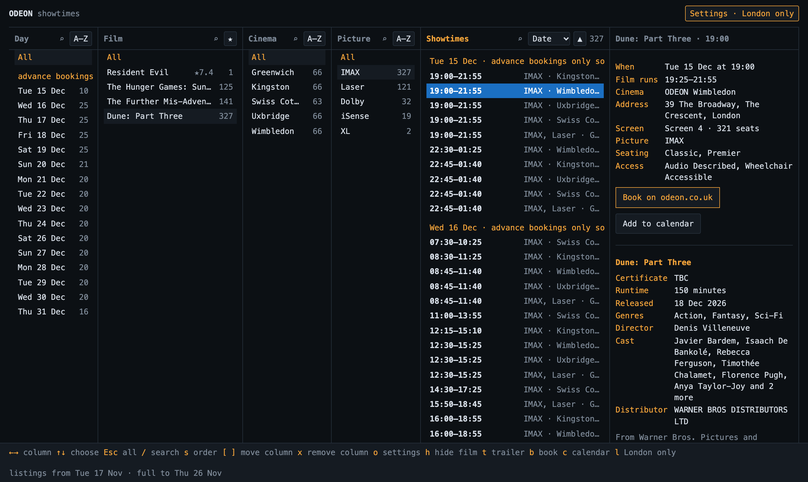
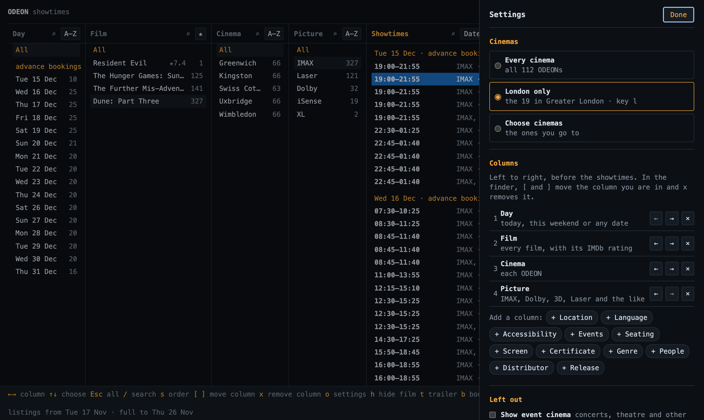
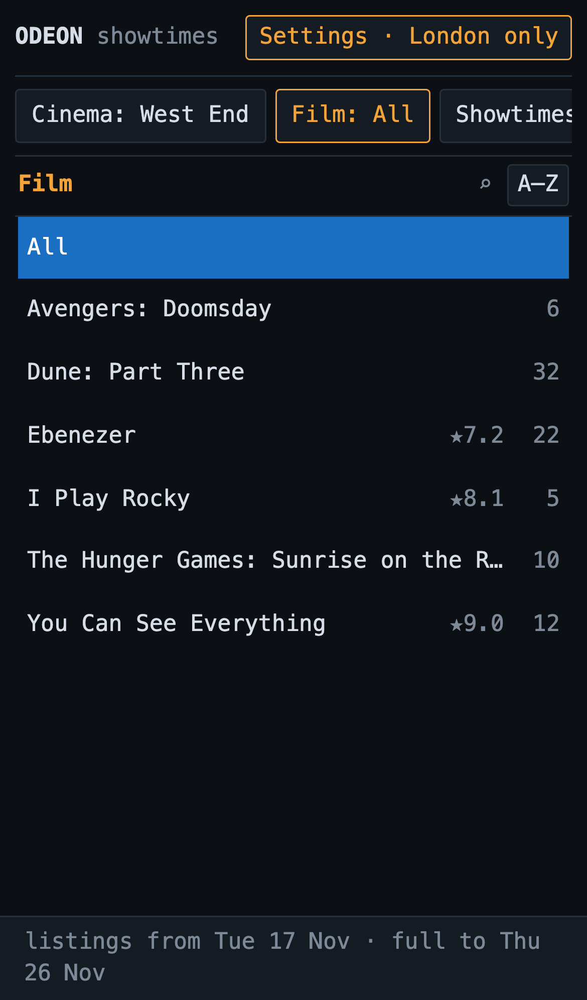
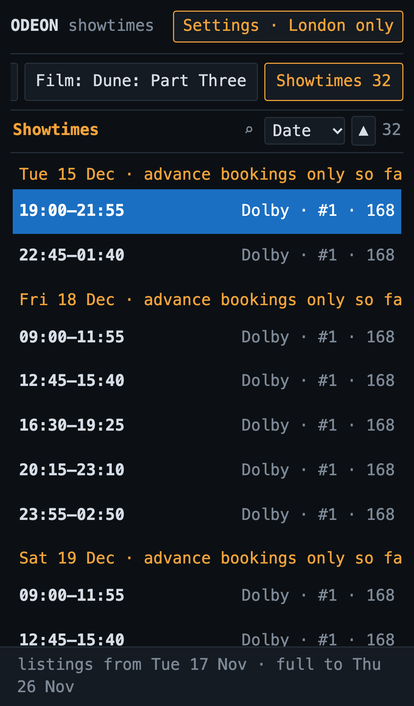
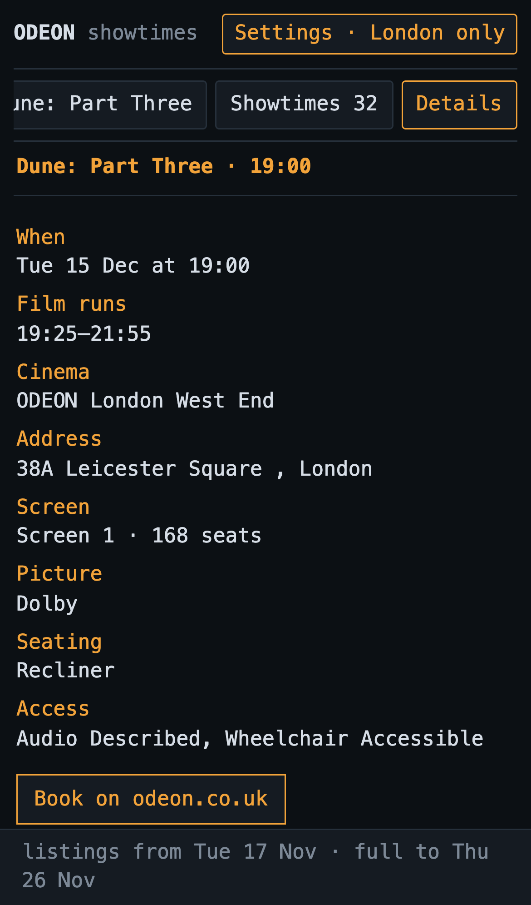

# ODEON listings

[](https://github.com/RoshBeed/odeon-web/actions/workflows/ci.yml)
[](https://github.com/RoshBeed/odeon-web/actions/workflows/deploy.yml)
[](https://github.com/RoshBeed/odeon-web/actions/workflows/ingest.yml)

**Live site: [odeon.ramuk.net](https://odeon.ramuk.net)** · Greater London only:
[odeon.ramuk.net/?cinemas=london](https://odeon.ramuk.net/?cinemas=london)

What's on at ODEON cinemas, on which screen, and how big that screen is. Pick a
cinema, a film, a day or a format in columns side by side; each column counts
what the others leave, and the matching showtimes and their details stay in
view. Nothing is booked here: each showing links to ODEON's own booking page and
can be added to your calendar.



## Using the site

1. **Choose where.** Open **Settings** (top right, or `o`) and pick *Every cinema*,
   *London only*, or *Choose cinemas* to tick the ones you go to.
2. **Choose your columns.** Settings lists the columns you show, left to right;
   move or remove each, and add others: Day (with Today and This weekend), Film,
   Cinema, Location, Picture, Language, Accessibility, Events, Seating, Screen
   (biggest first), Certificate, Genre, People, Distributor and Release (out now or
   opening soon).
3. **Narrow it down.** Pick something in any column. Every column shows how many
   showings each choice would leave, and **All** at the top of each takes a choice
   back. Search a column with `/`, and order it A–Z, by number of showings or
   (films) by rating with `s`.
4. **Pick a showtime.** Its details show beside it: the screen and its seats, the
   film's own start and end, the picture format, seating and access, the films
   you could see straight before or after it (double bills), and the film's
   synopsis, ratings and trailer. **Book on odeon.co.uk** opens ODEON's seat picker.
5. **Bookmark it.** The columns, your choices in them and your cinemas are all in
   the page address, and nothing is stored in the browser. A bookmark is a saved
   view, and a shared link opens the same way for anyone.

Concerts, theatre and other Event Cinema screenings, which a Limitless
membership does not cover, are left out unless you switch them on in Settings.
The footer says how fresh the listings are; ODEON publishes each week's full
schedule on Tuesday, and days after that hold advance bookings only.



### On a phone

One column shows at a time. The row of buttons along the top names each column
and what is chosen in it; tap one to go back to it. Choosing something moves on to
the next column, and tapping a showtime opens its details.

<p>
  
  
  
</p>

### Keys

| Key | Does |
| --- | --- |
| ← → | Move between columns |
| ↑ ↓ | Choose in a column, or move through the showtimes |
| Esc | Back to All in a column, or clear its search |
| / | Search the column you are in |
| s | Order the column you are in |
| [ ] | Move the column you are in left or right |
| x | Remove the column you are in |
| o | Settings |
| l | Switch London only on or off |
| h | Hide a film everywhere (Settings lists hidden films) |
| t | Play the trailer |
| b | Book the highlighted showing on odeon.co.uk |
| c | Add the highlighted showing to your calendar |

Everything also works by clicking or tapping.

## How it works

There is no server. Once a week a GitHub Actions workflow fetches the listings
from ODEON into one SQLite file. The site is plain files on GitHub Pages; the
browser downloads the listings once (under 1 MB, about 200 kB with London only)
and keeps them in memory, so every key press is answered at once.

### How it is put together

| Part | Where | What it does |
| --- | --- | --- |
| Ingest | `ingest/` (Python) | Fetches the week's listings and ratings and writes the SQLite file |
| Site | `site/` (TypeScript, Vite) | The interface; its build turns the file into JSON, which the page downloads once and holds in memory |
| Listings | the `data` release of this repository | The published `odeon.sqlite.gz`; also the ingest's only memory between runs |
| Workflows | `.github/workflows/` | `Ingest` (weekly), `Deploy` (GitHub Pages), `CI` |

The Ingest workflow checks hourly on Tuesdays and Wednesdays, when ODEON
publishes the week. Once the week is stored a check contacts nobody. When the
file changes it calls Deploy, which builds the new listings into the site.

ODEON refuses requests from cloud providers' addresses, GitHub's runners
included. The ingest therefore sends its ODEON traffic through a Tailscale exit
node on a home network (`scripts/via-tailnet.sh`). Nothing else uses it.

### Repository settings

| Kind | Name | Purpose |
| --- | --- | --- |
| Secret | `TAILSCALE_STATE` | The runner's permanent identity on the tailnet (base64 of a tailscaled state file) |
| Secret | `OMDB_API_KEY` | Optional. Enables IMDb and Metacritic scores |
| Variable | `TAILSCALE_EXIT_NODE` | Name of the exit node device |
| Variable | `ODEON_CINEMAS` | Optional. ODEON site IDs to store, comma-separated; empty stores every cinema |
| Variable | `ODEON_INGEST` | Optional. `false` pauses the schedule |

Start an ingest by hand:

```bash
gh workflow run ingest.yml -f command=run
```

`check` ingests only if this week is not stored yet; `run` ingests now. A failed
ingest is recorded in the file and tried again at the next check, at most three
times a week.

## Working on it

The site needs the listings file to show anything:

```bash
scripts/listings.sh download
```

Then, in `site/` (Node 26):

```bash
npm install
```

```bash
npm run listings
```

```bash
npm run dev
```

```bash
npm test
```

In `ingest/` (Python 3.13, [uv](https://docs.astral.sh/uv/)):

```bash
uv run python -m unittest discover -s tests
```

The ingest tests use a fake ODEON and a temporary database. To keep ODEON's
traffic minimal, do not run the real ingest more than the schedule does.
